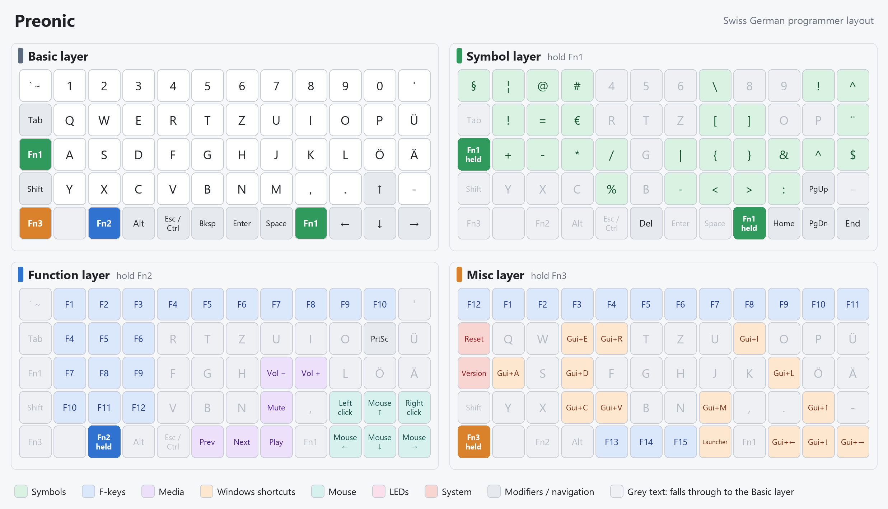
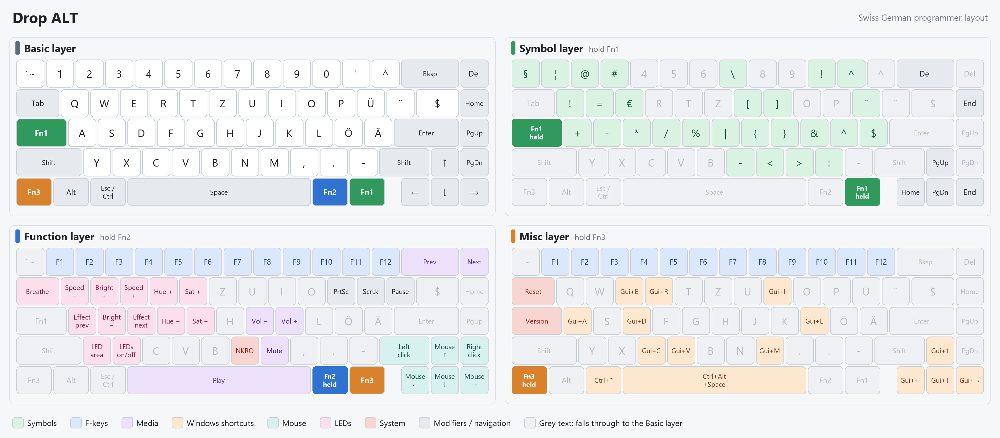
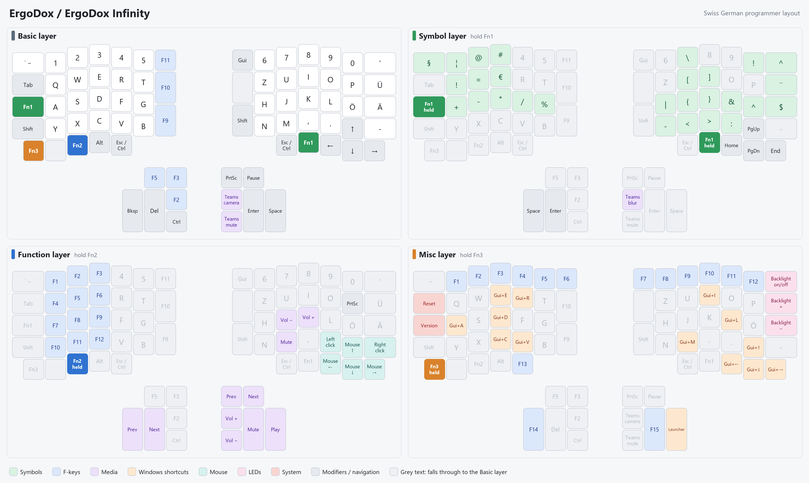

# swissgerman_programmer QMK userspace

My "Swiss German programmer" layout for Preonic, ErgoDox, ErgoDox Infinity and Drop ALT.
The host OS keyboard layout is expected to be **Swiss German**.

Builds run on GitHub Actions; no local toolchain needed. Every push builds the firmware and
publishes it as a GitHub release:

| Release      | Keyboard                                   | QMK version | File                                              |
|--------------|--------------------------------------------|-------------|---------------------------------------------------|
| `latest`     | Preonic (rev1)                             | master      | `preonic_rev1_swissgerman_programmer.hex`         |
| `latest`     | Original ErgoDox (built as ErgoDox EZ)     | master      | `ergodox_ez_base_swissgerman_programmer.hex`      |
| `latest`     | ErgoDox Infinity                           | master      | `input_club_ergodox_infinity_swissgerman_programmer.bin` |
| `latest-alt` | Original Drop ALT (`massdrop/alt`, SAMD51) | 0.26.11     | `massdrop_alt_swissgerman_programmer.bin`         |

The original Drop ALT was removed from QMK in 0.27.0, so it has its own workflow
(`.github/workflows/build_binaries_alt.yaml`) that builds against QMK 0.26.11 using the
target list in `qmk_alt.json`.

## Cheat sheets

Four layers on every keyboard: **Basic**, **Symbol** (hold Fn1), **Function** (hold Fn2) and
**Misc** (hold Fn3).

On the Drop ALT, while a Fn layer is held, the keys that do something on it light up in that
layer's colour from the cheat sheets (Symbol green, Function blue, Misc orange) and the other
keys go dark; the edge keeps its colour. Releasing the Fn key brings back the normal lighting.
The ErgoDox Infinity does the same with its single-colour key LEDs, and both of its displays
show the layer name with the backlight in the layer's colour.

### Preonic



### Drop ALT



### ErgoDox / ErgoDox Infinity



The images are generated from the keymap code. After changing a keymap, regenerate them with
`python tools/cheatsheets.py` (needs Pillow and the Segoe UI font that ships with Windows).

## Layout

| Path                                                       | Used by                     |
|------------------------------------------------------------|-----------------------------|
| `users/swissgerman_programmer/`                            | all: custom keycodes (`` ` ``/`~`, `^`, version) |
| `layouts/ortho_5x12/swissgerman_programmer/keymap.c`       | Preonic                     |
| `layouts/ergodox/swissgerman_programmer/keymap.c`          | ErgoDox (layer LEDs) and Infinity (LCD) |
| `keyboards/massdrop/alt/keymaps/swissgerman_programmer/`   | Drop ALT                    |
| `tools/cheatsheets.py`, `docs/cheatsheets/`                | cheat sheet generator and images |

## Building locally (optional)

With the QMK CLI installed:

```sh
qmk config user.overlay_dir="$(realpath .)"
qmk compile -kb preonic/rev1 -km swissgerman_programmer
```

## Flashing

On every keyboard, `QK_BOOT` (Reset) is on the Misc layer: hold Fn3 and press Tab.

- **Preonic rev1**: QMK Toolbox (Atmel DFU). Enter the bootloader with the reset button on the bottom, or Fn3 + Tab.
- **ErgoDox (Teensy)**: Teensy Loader or QMK Toolbox; press the Teensy reset button, or Fn3 + Tab.
- **ErgoDox Infinity**: QMK Toolbox (kiibohd DFU); flash *both* halves; reset button on the bottom, or Fn3 + Tab.
- **Drop ALT**: QMK Toolbox or Drop's `mdloader`; reset button through the hole on the bottom, or Fn3 + Tab.
